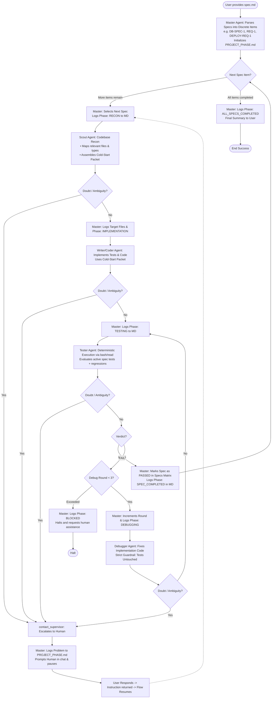

# pi-sequential-flow

> A sequential (non-parallel) multi-agent development, testing, and debugging orchestration package for the **Pi agent harness** and **pi-subagents**.

[](https://pi.dev)
[](LICENSE)

---

## Overview

When building complex software with AI agents, running a single monolithic prompt or unstructured swarms often leads to:
- **Small-model confusion**: Lightweight models write clean code for narrow tasks, but hallucinate or break dependencies when asked to navigate an entire repository.
- **Context bloat**: Grepping and searching across whole repos fills the main agent's context window, degrading reasoning over multi-step projects.
- **Untested code & test tampering**: Models often write code without tests, or worse, alter failing tests to get an artificial pass instead of fixing the underlying bug.

`pi-sequential-flow` solves this by introducing a **per-spec, sequential multi-agent pipeline** with strict role separation, scout reconnaissance, deterministic testing, anti-tamper bug fixing, and built-in Human-in-the-Loop (HITL) escalation.

---

## Architecture Flow



---

## Key Features

### 1. Per-Spec Execution
Instead of attempting the whole project in one gigantic turn, the Master Agent decomposes the specification into discrete units (e.g. `DB-SPEC-1`, `DB-SPEC-2`, `REQ-1`). It iterates through them sequentially, completing the full lifecycle for each item before advancing to the next.

### 2. Scout Reconnaissance & Cold-Start Packets
Downstream agents can run on smaller, fast, cost-effective models. Before writing code, the `scout` agent analyzes the codebase and generates a compact **Cold-Start Context Packet**:
- Exact target files to create or edit.
- Relevant existing interfaces, types, and schemas.
- Test runner command and directory conventions.

The `coder` receives this focused brief, enabling it to write high-quality code without needing to search or navigate the entire codebase.

### 3. Deterministic Tester (Read-Only)
The `tester` agent is restricted to execution and read tools (`bash`, `read`, `grep`, `find`, `ls`) with **no write or edit tools**. It deterministically runs the test suite and outputs structured `PASS` or `FAIL` verdicts with line numbers and stack traces.

### 4. Strict Test-Integrity Guardrail
The `debugger` agent is strictly prohibited from altering, weakening, or deleting test assertions to pass failing tests. It must fix the underlying application code. If a test itself contradicts the specification, the debugger must escalate to the human user for confirmation.

### 5. Comprehensive Human-in-the-Loop (HITL)
Every agent follows a **strict no-guessing policy**. If an agent encounters ambiguous requirements, contradictory patterns, or unresolvable environment barriers, it calls `contact_supervisor(reason: "need_decision")`. The Master pauses execution, logs the issue in `PROJECT_PHASE.md`, and prompts the user in the chat for direction.

### 6. Real-Time State Tracking (`PROJECT_PHASE.md`)
The Master Agent maintains `PROJECT_PHASE.md` in the workspace root, providing full visibility:
- **Specifications Matrix**: Status of all spec items (`PENDING`, `IN_PROGRESS`, `PASSED`, `FAILED`).
- **Human-in-the-Loop Log**: Audit trail of every question asked and answered.
- **Execution History**: Timestamped record of every agent phase and test result.

---

## Installation

### Prerequisites
- [Pi](https://github.com/earendil-works/pi) (v1.2.0 or newer)
- [`pi-subagents`](https://github.com/nicobailon/pi-subagents):
  ```bash
  pi install npm:pi-subagents
  ```

### Install this package
Install directly from GitHub via Pi:
```bash
pi install git:github.com/<your-username>/pi-sequential-flow
```
*(Or install locally during development: `pi install ./path/to/pi-sequential-flow`)*

---

## Usage

### 1. Create a `spec.md` File
Format your requirements using discrete spec item headers (e.g., `## DB-SPEC-1: ...`, `## REQ-1: ...`):

```markdown
# Shopping Cart Service

## SPEC-1: Cart Calculation
- **Description**: Implement function to calculate cart subtotal with item quantities.
- **Expected Interfaces**: `calculateSubtotal(items: CartItem[]): number`
- **Acceptance Criteria**:
  - [ ] Computes quantity * unit price for each item.
  - [ ] Returns 0 for an empty cart.
  - [ ] Throws `InvalidQuantityError` if any quantity <= 0.

## SPEC-2: Discount Coupon Engine
- **Description**: Apply percentage or fixed-amount discounts to cart subtotal.
- **Expected Interfaces**: `applyCoupon(subtotal: number, coupon: Coupon): number`
- **Acceptance Criteria**:
  - [ ] Percentage coupon reduces total by correct percentage.
  - [ ] Total cannot be negative (floors at 0).
  - [ ] Expired coupon throws `CouponExpiredError`.
- **Dependencies**: `SPEC-1`
```

*(See [`examples/SPEC_TEMPLATE.md`](examples/SPEC_TEMPLATE.md) for a reusable template).*

### 2. Run the Flow in Pi
Start Pi in your project directory:
```bash
pi
```

Invoke the command:
```text
/sequential-flow spec.md
```

You can also pass inline requirements:
```text
/sequential-flow "SPEC-1: Implement URL validator function with tests. SPEC-2: Implement query string parser with tests."
```

### 3. Follow Along
Watch the real-time updates in `PROJECT_PHASE.md`. If an agent needs clarification, answer the prompt in the Pi chat to keep the flow moving.

---

## Specialist Agents

| Agent | Scope | Key Tools | Thinking | Description |
| :--- | :--- | :--- | :--- | :--- |
| `scout` | Read-only | `read`, `grep`, `find`, `ls`, `bash`, `contact_supervisor` | `low` | Performs codebase reconnaissance and returns the Cold-Start Packet. |
| `coder` | Implementation | `read`, `write`, `edit`, `bash`, `contact_supervisor` | `high` | Implements tests and production code using the scout packet. |
| `tester` | Read-only execution | `bash`, `read`, `grep`, `find`, `ls`, `contact_supervisor` | `high` | Executes test runner and outputs deterministic PASS/FAIL verdict. |
| `debugger` | Targeted fixer | `read`, `write`, `edit`, `bash`, `contact_supervisor` | `high` | Repairs production bugs while preserving test assertions. |

---

## License

MIT © [Tiago Pereira](LICENSE)
